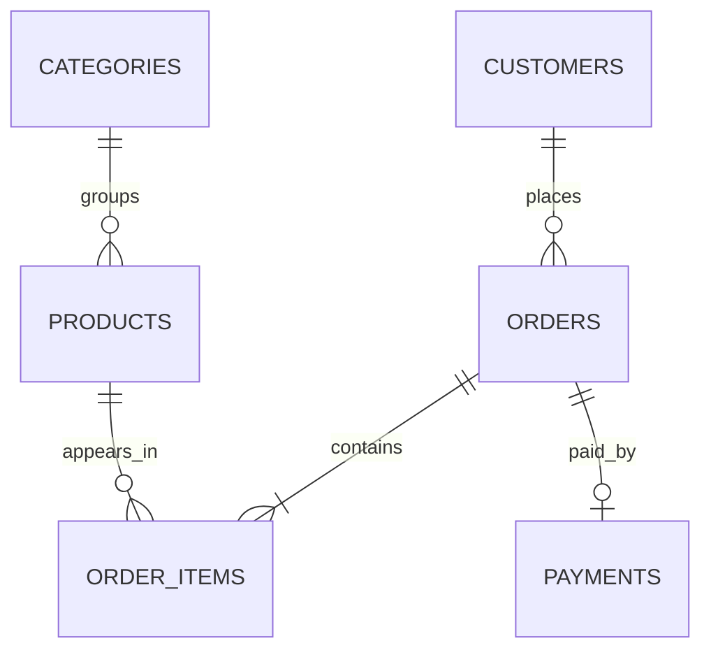

# Portfolio 1: Database Design and Modelling

## Case study
Organisation: NaijaMart (simulated scenario)
Nature of business: An online store in Lagos selling electronics, fashion and groceries, with delivery to customers.
Users of the database: customers, store staff, and the payments team.
Major data stored: customers, product categories, products, orders, order items, payments.
Key operations: register customers, add products, place orders, update stock, record payments, report on sales.

## ER diagram
(see mermaid block below)

## Relational schema
See schema.sql

## Keys and constraints
- Primary keys: every table has one.
- Foreign keys: link products to categories, orders to customers, order items to orders and products, payments to orders.
- UNIQUE: customer email.
- CHECK: price and stock cannot be negative, quantity must be above zero, order status limited to fixed values.
- NOT NULL on all required fields.

## Normalisation
- 1NF: every column holds one value, no repeating groups. Order lines live in their own table instead of a list inside orders.
- 2NF: in order_items the key is (order_id, product_id), and quantity and unit_price depend on the whole key.
- 3NF: no column depends on another non-key column. Category name is stored once in categories, not repeated per product. Order totals are calculated, not stored.
- unit_price in order_items is deliberate. It keeps the price at the time of purchase even if the product price changes later.

